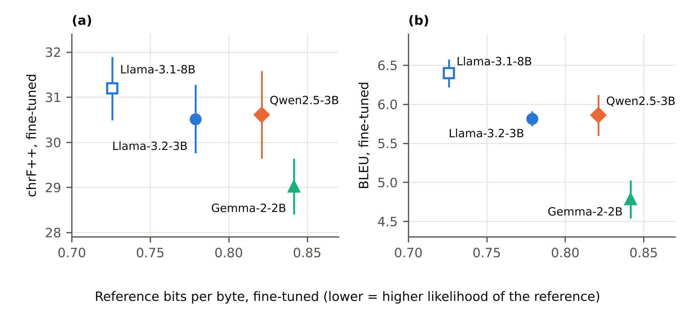
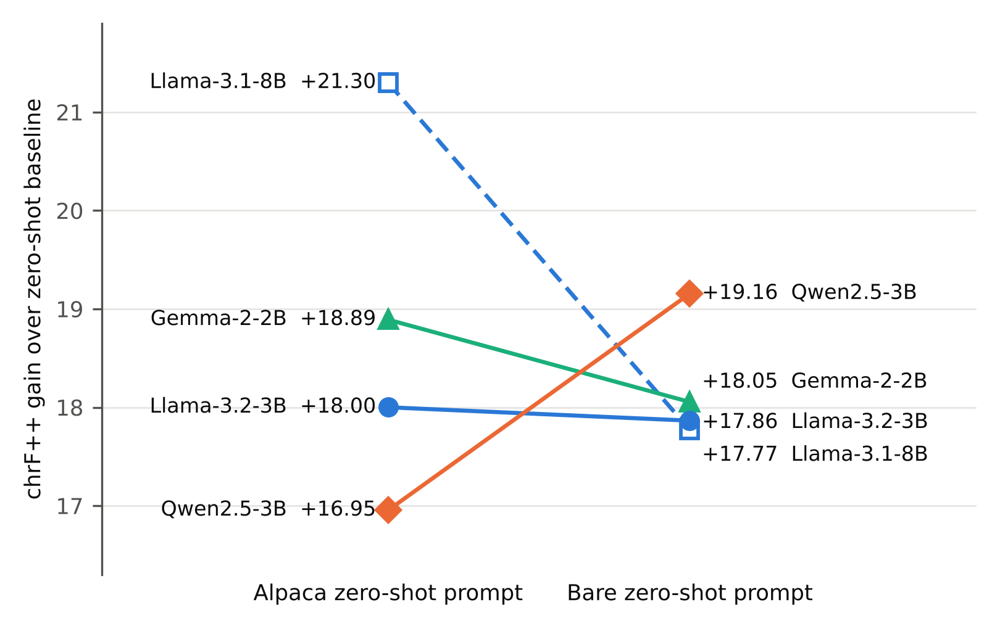

# Adapting Small Language Models to Romanized Nepali

[](#citation)
[](#citation)
[](LICENSE)
[](requirements.txt)

Code, per-item outputs, results and paper source for **"Adapting Small Language Models to Romanized Nepali: Tokenizer Fertility, Reference Likelihood and Generation Metrics"** by Pujan Pant, Sagar Newpane, Hari Sitaula and Manish Sakhakarmy.

We adapt three 2–3B base models (Llama-3.2-3B, Qwen2.5-3B and Gemma-2-2B) to Romanized Nepali with QLoRA, using three seeds each. We compare them on tokenizer fertility, byte-normalized reference likelihood (bits per byte) and generation metrics. The paper finds that these measures do not single out the same model.

<p align="center">
  
</p>

## Contents

- [Introduction](#introduction)
- [Overview](#overview)
- [Steps](#steps)
- [Results](#results)
- [Usage](#usage)
- [Repository structure](#repository-structure)
- [Conclusions](#conclusions)
- [Citation](#citation)
- [References](#references)
- [Licence](#licence)

## Introduction

> Nepali is written in Devanagari, yet much of its everyday digital use is in Latin script. Romanized Nepali has no standard spelling, and language models handle it less well than the native script.
>
> Small open models of 2–3B parameters can be adapted to it on a single 16 GB GPU. Choosing among them is hard, though, because the candidates differ in tokenizer, architecture, size and pretraining data all at once. Three common shortcuts have known weaknesses:
>
> - **Tokenizer fertility** (tokens per word) is an inconsistent predictor of downstream performance.
> - **Per-token perplexity** cannot be compared across tokenizers.
> - **A single training run** hides how much results vary with the seed.
>
> This repository accompanies a study that tests these shortcuts on a controlled Romanized Nepali instruction task.

## Overview

> **Data.** 10,500 examples (9,000 train / 500 validation / 1,000 test) are drawn from the Nepali instruction dataset [Saugatkafley/alpaca-nepali-sft](https://huggingface.co/datasets/Saugatkafley/alpaca-nepali-sft), a Nepali translation of Stanford Alpaca. They are romanized with lowercased ITRANS, which is deterministic: every word has exactly one spelling. The examples come in two formats:
>
> - **Type A:** English instruction, Romanized Nepali input and output.
> - **Type B:** all three fields in Romanized Nepali.
>
> **Models.** Llama-3.2-3B, Qwen2.5-3B and Gemma-2-2B (base checkpoints), plus Llama-3.1-8B as a within-family comparison. Llama-3.1-8B encodes our references identically to Llama-3.2-3B.
>
> **Measures.** Five kinds of measure are reported:
>
> - Tokenizer fertility.
> - Bits per byte (BPB) of the reference responses, which can be compared across tokenizers.
> - chrF++, BLEU, ROUGE and BERTScore.
> - An output audit for English-like output, prompt copying, repetition loops and empty outputs.
> - Zero-shot baselines under two prompt formats.

- Source dataset: <https://huggingface.co/datasets/Saugatkafley/alpaca-nepali-sft> (no licence stated on its card; we do not redistribute its text).
- Model cards: [Llama 3.2](https://github.com/meta-llama/llama-models/blob/main/models/llama3_2/MODEL_CARD.md), [Llama 3.1](https://github.com/meta-llama/llama-models/blob/main/models/llama3_1/MODEL_CARD.md), [Qwen2.5](https://arxiv.org/abs/2412.15115), [Gemma 2](https://arxiv.org/abs/2408.00118).

## Steps

1. **Data preparation** ([`data/README.md`](data/README.md))
   - Filtering removed examples that still contained Devanagari after transliteration and outputs shorter than three words. This left 48,106 eligible examples, from which 10,500 were sampled with seed 42.
   - The two formats are balanced 50/50 in every split:

     | Split | Examples | Type A | Type B | Empty input | SHA-256 prefix |
     |---|---:|---:|---:|---:|---|
     | Train | 9,000 | 4,500 | 4,500 | 5,576 | `9ed86da7…` |
     | Validation | 500 | 250 | 250 | 314 | `3f7f6854…` |
     | Test | 1,000 | 500 | 500 | 660 | `d656353e…` |

2. **Romanization**: lowercased ITRANS (R2). Lowercasing merges 11 letter groups, for example पनि and पानी both become `pani`. The fertility analysis also uses two alternative conventions:

   | Convention | नेपाल | पानी | तीन | Used for |
   |---|---|---|---|---|
   | R1: ITRANS | `nepAla` | `pAnI` | `tIna` | fertility analysis |
   | **R2: lowercased ITRANS** | `nepala` | `pani` | `tina` | **benchmark** |
   | R3: R2 without final inherent vowel | `nepal` | `pani` | `tin` | fertility analysis |

3. **Fine-tuning** ([`src/train.py`](src/train.py)): QLoRA (4-bit NF4) through Unsloth with rank-stabilized LoRA, using one recipe for all models:

   | Hyper-parameter | Value |
   |---|---|
   | LoRA rank / α / dropout | 32 / 64 / 0 (rsLoRA scale α/√r ≈ 11.3) |
   | Target modules | q, k, v, o, gate, up, down projections |
   | Learning rate | 1e-4, cosine, 200 warm-up steps |
   | Optimizer | 8-bit AdamW |
   | Effective batch | 8 (2 × 4 accumulation) |
   | Epochs / steps | 3 / 3,375 |
   | Max length | 512 tokens, no packing |
   | Checkpoint selection | lowest validation loss, every 100 steps |
   | Seeds | 42, 43, 44 |
   | Hardware | one NVIDIA T4 (16 GB) |

4. **Evaluation** ([`src/eval.py`](src/eval.py))
   - Decoding is greedy, with at most 256 new tokens and a repetition penalty of 1.1.
   - BPB is the summed reference negative log-likelihood divided by ln 2 times the reference length in UTF-8 bytes.
   - Metrics are sacreBLEU 2.6.0 for BLEU and chrF++, rouge-score 0.1.2 without stemming, and bert-score 0.3.13 with mBERT (no rescaling). Signatures are in [`docs/provenance.md`](docs/provenance.md).

5. **Re-analysis of the saved outputs** ([`analysis/`](analysis/))
   - Every reported chrF++, BLEU, ROUGE and BPB value is recomputed from the per-item outputs of the 19 retained runs ([`run_level_analysis.py`](analysis/run_level_analysis.py)).
   - Model differences get two kinds of 95% interval: a paired item-level bootstrap (2,000 resamples of the test items, averaged over each model's seeds) and a seed-level Welch interval.
   - Further analyses: tokenizer fertility under R1–R3 on public Nepali text, output lengths, the overlap of the English instructions with Alpaca, and parameter counts.

## Results

**Fine-tuned models** (1,000 test items; mean ± SD over three seeds; lower BPB is better):

| Model | chrF++ | BLEU | BERTScore F1 | BPB | Tokens per word |
|---|---:|---:|---:|---:|---:|
| Qwen2.5-3B | 30.61 ± 0.97 | 5.86 ± 0.26 | 0.757 ± 0.001 | 0.821 ± 0.003 | 2.997 |
| Llama-3.2-3B | 30.51 ± 0.76 | 5.81 ± 0.10 | 0.755 ± 0.001 | **0.779 ± 0.001** | 2.938 |
| Gemma-2-2B | 29.02 ± 0.62 | 4.78 ± 0.24 | 0.750 ± 0.001 | 0.842 ± 0.002 | **2.717** |
| Llama-3.1-8B (within-family) | 31.19 ± 0.70 | 6.40 ± 0.18 | 0.760 ± 0.0004 | 0.726 ± 0.002 | 2.938 |

**Differences between models** (first minus second; bold: the interval excludes zero):

| Comparison | Measure | Difference | Paired item-level 95% CI | Seed-level 95% CI |
|---|---|---:|---:|---:|
| Llama-3.2-3B − Qwen2.5-3B | BPB | −0.0423 | **[−0.0462, −0.0387]** | **[−0.0493, −0.0353]** |
| | chrF++ | −0.09 | [−0.50, 0.31] | [−2.12, 1.93] |
| | BLEU | −0.04 | [−0.56, 0.39] | [−0.62, 0.53] |
| Gemma-2-2B − Qwen2.5-3B | BPB | +0.0205 | **[0.0168, 0.0244]** | **[0.0142, 0.0268]** |
| | chrF++ | −1.59 | **[−2.01, −1.14]** | [−3.58, 0.40] |
| | BLEU | −1.08 | **[−1.51, −0.68]** | **[−1.65, −0.50]** |
| Gemma-2-2B − Llama-3.2-3B | BPB | +0.0628 | **[0.0580, 0.0684]** | **[0.0584, 0.0672]** |
| | chrF++ | −1.50 | **[−1.92, −1.06]** | [−3.09, 0.10] |
| | BLEU | −1.03 | **[−1.34, −0.75]** | **[−1.56, −0.51]** |
| Llama-3.1-8B − Llama-3.2-3B | BPB | −0.0530 | **[−0.0559, −0.0501]** | **[−0.0571, −0.0490]** |
| | chrF++ | +0.68 | **[0.26, 1.10]** | [−0.98, 2.33] |
| | BLEU | +0.58 | **[0.17, 1.09]** | **[0.21, 0.95]** |

**Zero-shot baselines.** Before fine-tuning, the three primary models score 10.1–13.7 chrF++, and 54–92% of their outputs are English-like. Which model gains most from fine-tuning depends on the zero-shot prompt:

<p align="center">
  
</p>

**Fertility and the romanization convention** (public sample of 1,233 sentences, tokens per word):

| Tokenizer | R1 | R2 (benchmark scheme) | R3 |
|---|---:|---:|---:|
| Gemma-2 | 2.493 | 2.135 | 2.069 |
| Llama 3 | 2.712 | 2.358 | 2.264 |
| Qwen2.5 | 2.733 | 2.387 | 2.294 |
| Mistral v0.1 | 3.053 | 2.648 | 2.536 |

## Usage

```bash
git clone https://github.com/pantpujan017/romanized-nepali-slm-adaptation.git
cd romanized-nepali-slm-adaptation
python -m pip install -r requirements.txt

# 1. Fetch the public tokenizer files and Nepali text (checksums are verified)
bash scripts/fetch_public_inputs.sh

# 2. BPB of every run and the BPB differences between models, from the released outputs
python analysis/bpb_check.py results/per_item results/run_level_results.json

# 3. Output lengths in each model's own tokens
python analysis/generation_length_analysis.py tokenizers results/per_item results/generation_length_results.json

# 4. Fertility under three romanization conventions
python analysis/tokenizer_romanization_analysis.py . results/tokenizer_romanization_results.json

# 5. Parameter counts and the precision of a three-seed SD
python analysis/derived_analyses.py results/derived_results.json

# 6. Figures 1 and 2
python analysis/make_figures.py results/run_level_results.json results/figures
```

chrF++, BLEU and ROUGE need the reference responses, which come from the source dataset and are not redistributed. Rebuild the test split from the source dataset (see [`data/README.md`](data/README.md)), then:

```bash
# add the references to the released outputs (checks the split's SHA-256 and every reference's length)
python scripts/restore_references.py path/to/test.jsonl results/per_item runs

# every chrF++, BLEU, ROUGE and BPB value, the paired and seed-level intervals, and the gains over zero-shot
python analysis/run_level_analysis.py runs results/run_level_results.json

# overlap of the English instructions with Stanford Alpaca (alpaca_data.json at commit 761dc5bf)
python analysis/alpaca_overlap.py path/to/test.jsonl alpaca_data.json results/alpaca_overlap_results.json
```

To build the paper, run `pdflatex main.tex` twice inside `paper/arxiv/`. The source is pdfLaTeX-only: Devanagari is embedded as images in `paper/arxiv/deva/`.

The training and evaluation scripts are in `src/`: `train.py` (canonical v2), `eval.py` (v2.2) and the launchers that run two seeds at once on a two-GPU Kaggle machine. [`src/README.md`](src/README.md) explains how to run them and lists their hashes.

## Repository structure

| Path | Purpose |
|---|---|
| `analysis/run_level_analysis.py` | Recomputes all metrics from the per-item outputs; paired item-level and seed-level intervals; gains over zero-shot |
| `analysis/bpb_check.py` | BPB and the paired BPB intervals from the released outputs alone |
| `analysis/generation_length_analysis.py` | Generated-output lengths in each model's tokens |
| `analysis/tokenizer_romanization_analysis.py` | Fertility of four tokenizers under three romanization conventions; lowercasing and inherent-vowel statistics |
| `analysis/alpaca_overlap.py` | Similarity of the English test instructions to Stanford Alpaca |
| `analysis/derived_analyses.py` | Parameter counts from the model configurations; interval for a three-seed SD |
| `analysis/make_figures.py` | Figures 1 and 2 of the paper |
| `results/per_item/` | Per-item generations, reference NLL and token and byte counts of the 19 retained runs (no prompts or references) |
| `results/bertscore_items/` | Per-item BERTScore of the four zero-shot runs whose metrics were recovered |
| `results/hf_tokenizer_audit/` | Fertility and length audits with the models' Hugging Face tokenizers |
| `results/*.json`, `results/figures/` | Outputs of the analyses |
| `scripts/fetch_public_inputs.sh` | Downloads the tokenizer files and public Nepali text and checks SHA-256 |
| `scripts/restore_references.py` | Adds the references from a rebuilt test split to the released outputs |
| `data/README.md` | Source dataset, filtering, splits, hashes and redistribution policy |
| `src/` | Training (`train.py` v2) and evaluation (`eval.py` v2.2) scripts, the parallel launchers, and `archive/train_v1.py` |
| `docs/provenance.md` | Scripts, hashes and package versions behind every reported number |
| `docs/run_records/` | Launch records, metric files and recovery records, and the Kaggle notebook of the Qwen2.5-3B runs |
| `paper/arxiv/` | LaTeX source of the preprint (arxiv-style template) |
| `paper/preprint.pdf` | Compiled preprint |
| `CITATION.cff` | Citation metadata |

## Conclusions

- All three 2–3B models adapt strongly. chrF++ rises from 10–14 to 29–31, and BPB falls to about a third of its zero-shot value.
- Byte-normalized likelihood and generation overlap disagree. Llama-3.2-3B assigns the references clearly higher likelihood than Qwen2.5-3B in every seed, but the two cannot be separated on chrF++ or BLEU, even with paired item-level tests.
- Fertility did not identify the best model. The tokenizer that splits words least, Gemma-2's, belongs to the model that scores lowest on every measure.
- The romanization convention changes fertility by about as much as the choice of tokenizer does. Lowercasing alone lowers it by 12.7–14.4%.
- Gains over zero-shot depend on the zero-shot prompt.
- Within the Llama family, where tokenization is identical, the 8B model's likelihood advantage carries over to generation only in part: +0.68 chrF++ and +0.58 BLEU, and only the BLEU gain is consistent across seeds.

## Citation

If you use this code or these results, please cite the preprint. The arXiv identifier will be added on release.

```bibtex
@article{pant2026romanizednepali,
  title   = {Adapting Small Language Models to Romanized Nepali: Tokenizer Fertility, Reference Likelihood and Generation Metrics},
  author  = {Pant, Pujan and Newpane, Sagar and Sitaula, Hari and Sakhakarmy, Manish},
  journal = {arXiv preprint},
  year    = {2026},
  note    = {Under review at ACM Transactions on Asian and Low-Resource Language Information Processing}
}
```

## References

1. A. Rimal and A. Rimal. 2026. Benchmarking Linguistic Adaptation in Comparable-Sized LLMs: A Study of Llama-3.1-8B, Mistral-7B-v0.1, and Qwen3-8B on Romanized Nepali. [arXiv:2604.14171](https://arxiv.org/abs/2604.14171).
2. T. Dettmers, A. Pagnoni, A. Holtzman and L. Zettlemoyer. 2023. QLoRA: Efficient Finetuning of Quantized LLMs. NeurIPS 2023.
3. D. Kalajdzievski. 2023. A Rank Stabilization Scaling Factor for Fine-Tuning with LoRA. [arXiv:2312.03732](https://arxiv.org/abs/2312.03732).
4. L. Gao et al. 2020. The Pile: An 800GB Dataset of Diverse Text for Language Modeling. [arXiv:2101.00027](https://arxiv.org/abs/2101.00027).
5. M. Popović. 2017. chrF++: Words Helping Character n-grams. WMT 2017. [doi:10.18653/v1/W17-4770](https://doi.org/10.18653/v1/W17-4770).
6. M. Post. 2018. A Call for Clarity in Reporting BLEU Scores. WMT 2018. [doi:10.18653/v1/W18-6319](https://doi.org/10.18653/v1/W18-6319).
7. P. Rust et al. 2021. How Good is Your Tokenizer? ACL-IJCNLP 2021. [doi:10.18653/v1/2021.acl-long.243](https://doi.org/10.18653/v1/2021.acl-long.243).
8. R. Taori et al. 2023. Stanford Alpaca: An Instruction-following LLaMA Model. [github.com/tatsu-lab/stanford_alpaca](https://github.com/tatsu-lab/stanford_alpaca).
9. R. Ardila et al. 2020. Common Voice: A Massively-Multilingual Speech Corpus. LREC 2020. [aclanthology.org/2020.lrec-1.520](https://aclanthology.org/2020.lrec-1.520).

The full reference list is in the paper.

## Licence

- **Code** in this repository: [MIT](LICENSE).
- **Paper text and figures:** CC BY 4.0.
- **LaTeX style file** `paper/arxiv/arxiv.sty`: by George Kour ([kourgeorge/arxiv-style](https://github.com/kourgeorge/arxiv-style)), MIT.
- **Source instruction data:** not redistributed. It states no licence and is a translation of Stanford Alpaca, which is CC BY-NC 4.0.
- **Model outputs** (`results/per_item/`): released for research reproducibility. Their use is subject to the licences of the models that produced them. Some outputs, mostly zero-shot ones, copy parts of their prompt (Table 6 of the paper).
- **Models:** used under their own licences: the Llama 3.2 and 3.1 Community Licenses, the Gemma Terms of Use and the Qwen Research License.
